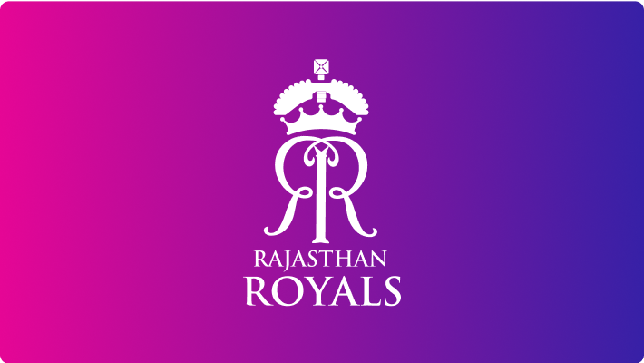

<p align="center">
  <a href="https://www.rajasthanroyals.com/about-us"></a>
</p>

<h1 align="center">SUPERR SELECTOR</h1>
<p align="center"><strong>IPL Pressure Performance Analytics</strong></p>
<p align="center">An evidence-led cricket analytics solution for understanding how players perform when match conditions become demanding.</p>

<p align="center">
  <a href="https://api.unstop.com/hackathons/crp-superr-selector-season-2-help-shape-rajasthan-royals-ipl-2027-auction-strategy-rajasthan-royals-1792758"></a>
  <a href="#methodology"></a>
  <a href="#player-rankings"></a>
  <a href="https://github.com/moonylit/SupeRR-Selector"></a>
  <a href="outputs/reports/pressure_methodology.txt"></a>
</p>

<p align="center">
  
  
  
  
  
</p>

<p align="center"><a href="https://www.rajasthanroyals.com/">Rajasthan Royals</a> &nbsp;·&nbsp; <a href="https://api.unstop.com/hackathons/crp-superr-selector-season-2-help-shape-rajasthan-royals-ipl-2027-auction-strategy-rajasthan-royals-1792758">SupeRR Selector Season 2</a></p>

---

## About the project

In cricket, pressure is shaped by the situation: the score to chase, wickets in hand, balls remaining, and the phase of an innings. SupeRR Selector turns those match conditions into a repeatable analytical framework for comparing historical batting and bowling performance.

The solution evaluates pressure performance against relevant historical baselines, then considers consistency and evidence volume before creating separate batter and bowler rankings. The result is a transparent view of recorded performance under defined match states—not a psychological assessment or a trained forecast of future results.

## Key highlights

<table>
  <tr>
    <td align="center" width="25%"><strong>200,999</strong><br>ball-by-ball records</td>
    <td align="center" width="25%"><strong>1,167</strong><br>batter / competition records</td>
    <td align="center" width="25%"><strong>806</strong><br>bowler / competition records</td>
    <td align="center" width="25%"><strong>57</strong><br>automated tests passing</td>
  </tr>
</table>

<table>
  <tr>
    <td align="center" width="33%"><strong>67</strong><br>eligible IPL batting candidates</td>
    <td align="center" width="33%"><strong>25</strong><br>eligible IPL bowling candidates</td>
    <td align="center" width="34%"><strong>300</strong><br>match-bootstrap replicates</td>
  </tr>
</table>

| Model capability | What it provides |
| --- | --- |
| Role-specific evaluation | Separate historical top-ten lists for batters and bowlers |
| Walk-forward comparisons | Historical baselines built from earlier observations |
| Match-level uncertainty | Bootstrap sensitivity summaries alongside player scores |
| Evidence-aware ranking | Eligibility rules reflect exposure, history, and reliability |

Dataset and player-record counts are verified against committed profiling and validation reports. Eligibility and bootstrap counts come from a fresh final run using the latest merged `main` implementation and the authorized local input pack. The full test suite passed on that same merged code.

## How it works

### Pressure situations

The match-state engine evaluates context before a delivery. Pressure opportunities use walk-forward thresholds within competition and innings context, so the delivery's eventual outcome does not define whether that delivery was under pressure. The pressure score is a contextual proxy: it describes match conditions, not a player's internal state.

### Batting evaluation

Batting analysis compares pressure outcomes with a player's prior non-pressure history, using context-matched baselines where evidence permits and broader historical fallback when needed. The scoring keeps four views visible: absolute pressure performance, relative performance versus baseline, match-to-match consistency, and evidence-volume reliability. Peer and reliability shrinkage temper estimates supported by limited history.

### Bowling evaluation

Bowling analysis uses its own pressure index and evaluates economy, wickets, dot balls, boundaries, and bowler-charged extras against a format-aware historical baseline. Rates use confirmed legal-ball exposure; uncertain delivery details remain flagged. Peer shrinkage, match consistency, and evidence reliability contribute to the composite evaluation.

### Ranking and statistical safeguards

- Eligibility rules require meaningful pressure exposure and sufficient baseline history; bowling also uses pressure-innings and baseline-coverage requirements.
- Match-level bootstrap resampling and alternative-model comparisons show how rankings vary under the implemented analysis choices.
- Score and tie-break rules are deterministic, with stable player identifiers used for aggregation and final tie resolution.
- Batter and bowler rankings are calculated independently. Their scores use different constructions and should not be compared with each other.

## Player rankings

These are separate top-ten **historical IPL evaluations**, ordered by the role-specific composite score. Scores are shown to two decimal places; the batting and bowling scales are independently constructed and must not be compared with each other. The tables are summaries generated from the latest merged `main` implementation and authorized competition inputs; the derived result files themselves are not linked or included in the repository.

### Batters · historical IPL ranking

| Rank | Batter | Score / 100 |
| ---: | --- | ---: |
| 1 | Sai Sudharsan | 59.57 |
| 2 | Virat Kohli | 57.16 |
| 3 | Heinrich Klaasen | 56.76 |
| 4 | Shikhar Dhawan | 56.52 |
| 5 | Shivam Dube | 56.46 |
| 6 | Riyan Parag | 56.17 |
| 7 | Aiden Markram | 55.87 |
| 8 | Sanju Samson | 55.62 |
| 9 | Shubman Gill | 55.44 |
| 10 | Suryakumar Yadav | 55.37 |

### Bowlers · historical IPL ranking

| Rank | Bowler | Score / 100 |
| ---: | --- | ---: |
| 1 | Noor Ahmad | 78.55 |
| 2 | Axar Patel | 69.29 |
| 3 | Maheesh Theekshana | 67.76 |
| 4 | Suyash Sharma | 65.15 |
| 5 | Piyush Chawla | 63.56 |
| 6 | Krunal Pandya | 62.71 |
| 7 | Ravi Bishnoi | 62.67 |
| 8 | Yuzvendra Chahal | 60.84 |
| 9 | Rashid Khan | 60.62 |
| 10 | Ravindra Jadeja | 60.17 |

## Methodology

The modelling approach is designed to make comparisons useful and auditable:

1. **Establish context.** Reconstruct pre-delivery match states and define pressure opportunities from prior observations.
2. **Build a fair comparison.** Compare pressure performance with historical personal baselines and use format-aware peer history where personal evidence is sparse.
3. **Evaluate more than output.** Keep absolute performance, baseline-relative performance, consistency, and reliability visible as distinct scoring dimensions.
4. **Quantify sensitivity.** Use match-level bootstrap summaries and alternative composite comparisons to show uncertainty and ranking sensitivity.
5. **Apply evidence gates.** Require adequate pressure exposure and baseline evidence before a player enters a role-specific ranking.

Detailed, committed references: [pressure methodology](outputs/reports/pressure_methodology.txt), [batting methodology](outputs/reports/batting_methodology.txt), [bowling methodology](outputs/reports/bowling_methodology.txt), [dataset profile](outputs/reports/dataset_profile.txt), and [bowling validation](outputs/reports/bowling_validation.txt).

## Technology stack

<p>
  
  
  
  
  
  
  
  
  
</p>

The badges reflect dependencies listed in [`requirements.txt`](requirements.txt) and the test suite included in the repository. There is no license file, CI badge, or coverage badge.

## Project architecture

```text
SupeRR-Selector/
├── app/                  # Streamlit application
├── assets/branding/      # Official Rajasthan Royals brand asset
├── data/                 # Data handling notes; authorized data stays local
├── notebooks/            # Notebook workspace
├── outputs/
│   ├── figures/          # Committed model and analysis figures
│   ├── processed/        # Generated data tables (not tracked)
│   ├── rankings/         # Generated rankings (not tracked)
│   └── reports/          # Committed methodology and validation reports
├── src/
│   ├── analysis/         # Exploratory analysis
│   ├── data/             # Loading, validation, profiling, calculations
│   ├── evaluation/       # Bootstrap uncertainty analysis
│   ├── models/           # Batting, bowling, and final ranking logic
│   ├── pressure/         # Match-state and pressure calculations
│   └── reporting/        # Reporting package namespace
├── tests/                # Automated tests
├── config.py             # Shared paths and model configuration
├── main.py               # Command-line pipeline
└── requirements.txt      # Python dependencies
```

## Getting started

Requires Python 3.10 or later. The proprietary competition data pack is not included. Use authorized input data under its applicable terms; the pipeline does not download or redistribute the pack.

```bash
python -m venv .venv
```

Activate the environment and install dependencies:

```powershell
.\.venv\Scripts\Activate.ps1
python -m pip install --upgrade pip
pip install -r requirements.txt
```

On macOS or Linux, activate it with `source .venv/bin/activate`.

Run the integrated final analysis from the repository root:

```bash
python main.py --phase final
```

The CLI also supports `profile`, `eda`, `pressure`, `batting`, and `bowling` runs. See `python main.py --help` for options. Generated data-derived ranking and delivery files remain local and are not published by this repository.

Run the automated tests:

```bash
python -m pytest -q
```

## Competition

**Built for [SupeRR Selector Season 2 — Rajasthan Royals](https://api.unstop.com/hackathons/crp-superr-selector-season-2-help-shape-rajasthan-royals-ipl-2027-auction-strategy-rajasthan-royals-1792758).** The competition brief challenges participants to analyze reliable performance under pressure in support of IPL 2027 scouting. This repository makes no claim of being selected, shortlisted, accepted, or endorsed by the organizers.

The Rajasthan Royals logo above is an unmodified official image asset hosted on the [Rajasthan Royals website](https://www.rajasthanroyals.com/about-us), saved locally at `assets/branding/rajasthan-royals-official.png` for reliable rendering. No authentic SupeRR Selector competition logo could be verified, so the competition identity is represented by the typographic title above.

## Disclaimer & statistical limits

- Pressure is a match-state proxy, not a measurement of a player's psychology or a causal pressure effect.
- All ten selected batters' pressure-minus-baseline bootstrap intervals cross zero. The batting top ten also changes under an alternative correlation-reduced composite (5 of 10 overlap; Spearman 0.620).
- Bowling top-ten resample inclusion frequencies range from 53.3% to 100%. These are conditional bootstrap results, not future-performance or selection probabilities.
- Rankings describe historical performance; they are not predictions or confirmed IPL 2027 auction recommendations. The final registered auction pool has not been verified, and retained players may appear in the historical lists.
- This is an independently developed competition project, not an official Rajasthan Royals product or an endorsed submission.
